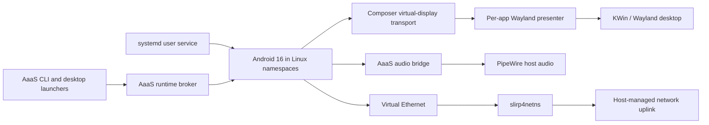

# Android-as-a-Service (AaaS)

AaaS runs Android 16 applications in individual Wayland windows on x86_64 Linux. A persistent Android runtime owns shared desktop bridges; launching an application creates its display endpoint and presenter, and closing it releases those resources.

This is an experimental **trusted development runtime**. Live acceptance covers one Arch Linux/KWin host; other distributions and compositors have not been certified. It is not a production security sandbox.

## Host requirements

The verified host is Arch Linux x86_64 with KDE Plasma/KWin on Wayland and a
systemd user session. AaaS also needs unprivileged user namespaces, binderfs,
`/dev/fuse`, unified cgroup v2, and a DRM render node for the accelerated
presenter. Run `./aaas doctor` to check the host capabilities and report missing
requirements; only Arch/KWin has been exercised end to end. A compatible Android
16 diagnostic image and runtime dependencies are supplied separately from this
source checkout.

## Architecture

Android 16 userspace runs in Linux namespaces as a persistent user service.
The AaaS broker maps Android virtual displays to per-application Wayland
presenters; the physical Wi-Fi device stays under the host network manager.



**Publication status:** A public source or binary release is not available yet. The current engineering bundle `engineering-830eef7` contains an Android diagnostic image with SELinux authorization shims; its manifest ID is `d3d7278094324b93be4f3ad57ae5883d`; it is not approved for untrusted APKs or public binary redistribution. See [current release readiness](docs/release-readiness-2026-11-11.md) and the [dependency/license review](docs/dependencies-and-licenses.md).

## Installation and use

There is currently **no public installable release**. The local engineering bundle is diagnostic-only and is not cleared for redistribution. If you have an authorized local bundle, it must contain `install`, the Android rootfs, runtime components and integrity metadata; a source checkout alone does not provision the prepared Android image. From the extracted bundle root:

```sh
./install --workspace "$HOME/.local/share/aaas/workspaces/android16" \
  --installation "$HOME/.local/share/aaas/installations/android16" \
  --config-home "$HOME/.config/aaas" \
  --data-home "$HOME/.local/share/aaas"
```

Use the installed executable explicitly if it is not on your PATH:

```sh
AAAS="$HOME/.local/share/aaas/installations/android16/bin/aaas"
"$AAAS" runtime install-service
"$AAAS" runtime start
"$AAAS" runtime status
"$AAAS" apps install /path/to/trusted.apk
"$AAAS" apps list
"$AAAS" apps launch com.android.settings
"$AAAS" apps running
"$AAAS" logs
"$AAAS" runtime stop
```

The generated user service is `aaas-runtime.service`. Use `apps close SLOT` to close one window. Updates use `update /path/to/bundle`; `rollback` restores the retained prior runtime. `uninstall` preserves userdata by default. See the [installation guide](docs/portable-development-release.md); dated acceptance sections there describe earlier candidates, not automatic acceptance of every new bundle.

## Implemented capabilities and boundaries

- Persistent Android with zero-window idle; independent windows, input, focus and Android framebuffer resizing. The source fix that keeps a Wayland toplevel alive across Composer reconnects during resize is included in candidate `engineering-830eef7`; automated source coverage and earlier live evidence exist, but interactive resize was not repeated on this exact fresh installation ([evidence](results/m1a/dynamic-resize-acceptance-2026-11-11.json)). Android may retain its previous frame briefly while rebuilding the resized display.
- Historical nine-application simultaneous-window acceptance on KWin.
- ARM translation through the existing Native Bridge has been demonstrated historically, but direct translation execution was not independently captured on this exact fresh candidate; tested apps do not establish universal ARM compatibility.
- PipeWire audio, microphone, clipboard and Plasma notifications. [Human listening evidence](results/audio/human-listening-2026-11-10.json) records audible playback on the development laptop.
- [Android networking](docs/android-networking.md) uses rootless slirp4netns and validated virtual Ethernet over the host connection. Android Wi-Fi hardware/SSIDs are unsupported.
- Scoped shared storage is implemented. Gallery external-cache/project-quota compatibility remains limited.
- Physical Bluetooth/peripheral mediation and other compositors have separate acceptance boundaries.

Android SELinux enforcement is unavailable in the diagnostic profile. Use only trusted APKs. Android image provenance, redistribution licensing, public release authentication and production security require further closure. A manifest hash verifies integrity, not publisher identity.

## Development and testing

A source checkout does not include or provision the prepared Android image. See
the [developer runtime guide](docs/developer-runtime.md) for dependencies,
workspace preparation, image inputs, and component builds. The [M5 build-input
guide](docs/m5-portable-development-release.md) documents the declared helper
APK, signing, and audio-overlay inputs. The Android platform image is still a
prepared diagnostic input rather than a complete reproducible AOSP build.

Run the Python suite with:

```sh
./aaas doctor
./aaas help
python3 -m unittest discover -s tests -q
```

The Python suite ran 557 tests on 2026-11-11: 551 passed and 6 were skipped in the corrected source worktree; unit tests do not establish live graphical, audio, or network acceptance. See the [release readiness record](docs/release-readiness-2026-11-11.md) for exact-candidate results and remaining gates. Five service cycles, Android-to-PipeWire transport, and an Android ConnectivityManager/DNS/TLS-HTTPS probe passed on that candidate. Uninstall/reinstall passed; update/rollback remains unverified.

The [image assembly guide](docs/android-rootfs-reconstruction.md) describes the separate, incomplete upstream-image reconstruction path.

Do not commit userdata, private keys or generated binaries. Preserve existing work and use focused Conventional Commits with relevant regression evidence.

## Update, removal, and troubleshooting

On an installed local bundle, `aaas update /path/to/bundle` stages an update,
`aaas rollback` restores the retained prior bundle, and `aaas uninstall` removes
the installed runtime while preserving user data by default. These commands are
documented in the [portable installation guide](docs/portable-development-release.md);
they are not available as a public download while the bundle remains uncleared.
For host and runtime diagnostics, run `aaas doctor`, `aaas runtime status`, and
`aaas logs`. See [runtime troubleshooting](docs/developer-runtime.md) and the
[candidate acceptance record](docs/release-readiness-2026-11-11.md).

## Security and licensing

The current profile is intended for trusted local development. SELinux enforcement
is unavailable, APKs are not isolated to production standards, and bundle hashes
provide integrity checks rather than publisher authentication. The repository
has no AaaS project license grant. Upstream licenses for components do not grant
rights to the AaaS source or to the diagnostic Android image. Public source and
binary redistribution therefore remain unapproved.

## Documentation

- [Runtime configuration and host diagnosis](docs/developer-runtime.md)
- [Portable install, update and uninstall](docs/portable-development-release.md)
- [Graphics architecture](docs/m1e-architecture.md)
- [Desktop integration](docs/milestones/m4-native-desktop-integration.md)
- [ARM compatibility](docs/compatibility/arm64-applications.md)
- [Networking](docs/android-networking.md)
- [Persistent userdata](docs/storage/android-persistent-userdata.md)
- [Storage capacity policy](docs/storage/workspace-capacity-policy.md)
- [Security boundaries](docs/security/rootless-android-architecture.md)
- [Dependency and license inventory](docs/dependencies-and-licenses.md)
- [Local release readiness and candidate evidence](docs/release-readiness-2026-11-11.md)
- [Exact-candidate acceptance record](results/release/candidate-acceptance-engineering-830eef7-2026-11-11.json)
- [Exact-candidate file-level SBOM](results/release/sbom-engineering-d3d72780.json)
- [Security review](docs/release/security-review-2026-11-11.md)
- [Release notes draft](docs/release/release-notes-draft-2026-11-11.md)

Historical milestone documents retain their dated findings. Machine-specific mount paths, device identifiers, UUIDs, and temporary paths in those records have been normalized to placeholders such as `$AAAS_WORKSPACE`, `$AAAS_WORKSPACE_DEVICE`, and temporary paths; those variables may need to be set before adapting old commands. The repository does not include a project-level license grant, and no project-wide license should be inferred from upstream component licenses. Source publication and binary redistribution are not approved; the [dependency inventory](docs/dependencies-and-licenses.md) records the unresolved rights and provenance gaps. No GitHub repository or public release has been configured.
