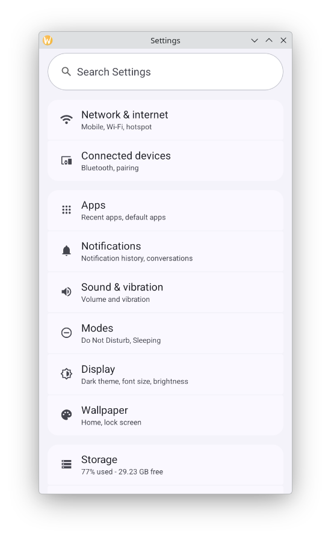
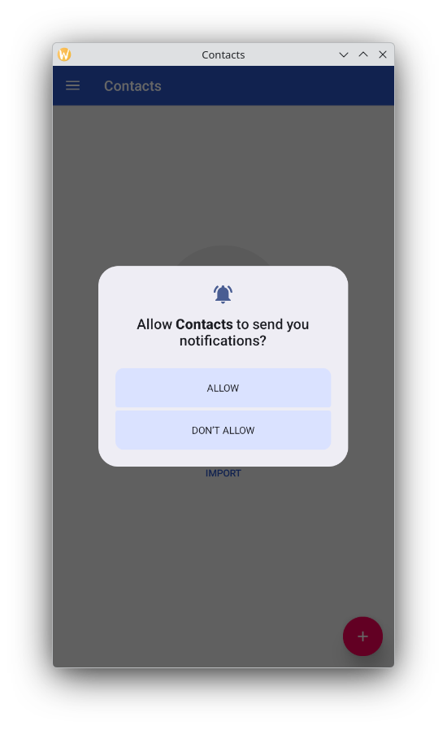
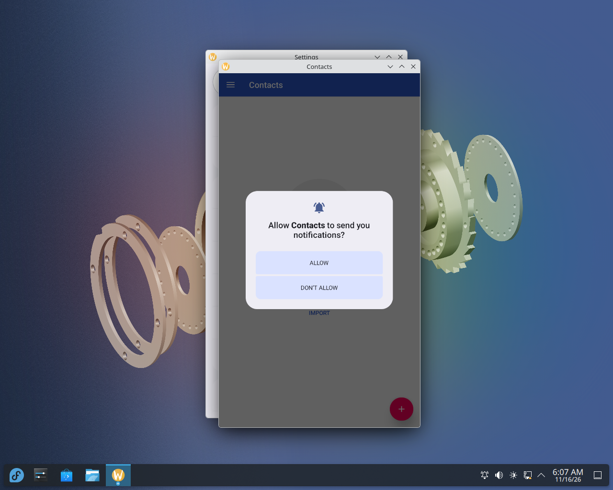
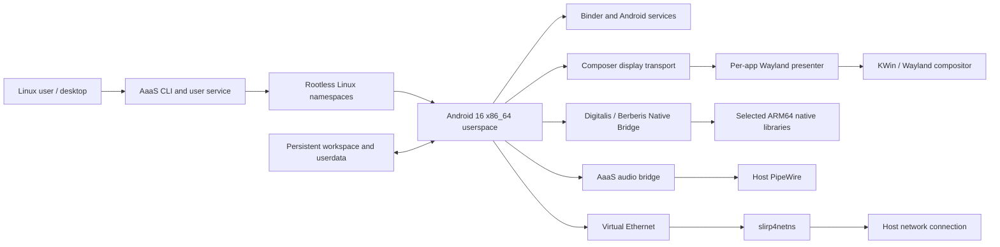

# Android as a Service (AaaS)

Run Android 16 applications as individual Linux desktop windows. AaaS uses a
shared-kernel, namespace-isolated Android userspace and connects its application
surfaces to a Wayland desktop; the Android runtime itself is not a full guest
virtual machine.

> **Developer preview:** M5 functional acceptance is closed for the exact
> candidate `engineering-af3dcb4` (bundle ID
> `43d04579ec874746a7c9da5152419bd6`). It passed the recorded Arch Linux host
> and Fedora 45 test-VM checks. This is a trusted local development runtime,
> not a security-approved or publicly distributable product. No binary download
> is published. See [release notes](docs/release/v0.1.0-dev-preview.md) and
> [acceptance evidence](docs/release/portable-preview-af3dcb4-acceptance.json).

## What AaaS does

AaaS keeps one Android runtime available while opening Android applications in
separate desktop windows. This gives Linux developers access to Android apps
and services without making a conventional Android VM the runtime architecture.
The Fedora virtual machine described below was only a test environment.

The project exists to explore how Android application lifecycle, graphics,
input, audio, networking, and selected native ABIs can integrate with a Linux
desktop while remaining manageable as a user service.

## Developer-preview status

The exact accepted bundle is available only as a local engineering artifact.
The bundle manifest and runtime dependency closure passed, but the Android image
and a substantial portion of bundled executable provenance have not been
cleared for public redistribution. Apache-2.0 now applies to eligible original
AaaS source code the project owner is authorized to license. It does not cover
independently licensed files, the Android SDK-derived image, or the accepted
prebuilt runtime. The cleaned source tree and its notices have completed a
focused publication-safety review; the owner's approved historical identities
and paths are retained. No source release has been published.

### Demonstration

These genuine screenshots were captured during the accepted
`engineering-af3dcb4` Fedora 45/KWin test-VM run. They show the test desktop,
not a synthetic mockup. Fedora was tested as a VM guest; AaaS does not require a
VM to run. The VM used temporary SELinux permissive mode for this diagnostic
acceptance, then returned to Enforcing.



*Settings window on the accepted candidate.*



*Contacts window on the accepted candidate.*



*Two Android application windows presented concurrently.*

## Working capabilities

| Capability | Demonstrated scope |
|---|---|
| Android runtime | Android 16, x86_64, in a persistent user-managed runtime |
| Desktop windows | Settings and Contacts, independent windows, KWin/Wayland presentation and frame release |
| ARM applications | A deterministic ARM64 JNI fixture through Android Native Bridge using Digitalis/Berberis translation; selected application libraries also exercised |
| Networking | Android virtual Ethernet with DNS and HTTPS; the accepted probe returned HTTP 204 over TLS 1.3 |
| Audio | Android PCM transported through the AaaS PipeWire bridge; earlier Fedora diagnostic evidence includes human-confirmed audible tones |
| Lifecycle | Start, stop, restart, fresh isolated install, uninstall, and owned-resource cleanup |

These bounded results do not establish universal Android or ARM64 app
compatibility, native ARM64 performance, every Android HAL, or support for every
Linux distribution, compositor, GPU, or desktop session.

## Architecture

Android userspace runs in Linux namespaces and uses the host kernel. Android
Binder and system services manage applications. The AaaS Composer transport
provides per-application Android displays; a Wayland presenter maps each app
surface to a desktop toplevel and forwards input. Buffers use the implemented
graphics transport paths; this project does not claim every path is zero-copy.
The ARM64 path is dynamic Native Bridge translation to x86_64, not native ARM64
execution. PipeWire and a virtual Ethernet helper bridge audio and networking.



See the [architecture guide](docs/architecture.md) for the component boundaries
and the [portable release guide](docs/portable-development-release.md) for
installation and lifecycle details.

## Tested operating systems

- **Arch Linux x86_64**, KDE Plasma/KWin on Wayland: host acceptance.
- **Fedora 45 x86_64**, KDE Plasma/KWin 6.8.2 on Wayland: tested in a disposable
  VM. Fedora functional acceptance used an explicit temporary SELinux
  permissive setting inside that VM, restored to Enforcing afterward. Fedora
  SELinux Enforcing compatibility is not supported or claimed.

Other distributions, compositors, kernels, GPU combinations, and desktop
sessions are unverified. The Fedora test environment must not be interpreted as
a recommendation to disable SELinux on a general-purpose machine.

## Prerequisites

The accepted test hosts used x86_64 Linux, a KDE/KWin Wayland session, user
namespaces, BinderFS, FUSE, cgroup v2, DRM render-node access, and the host
libraries and tools reported by `aaas doctor`. Audio requires an active PipeWire
user session; the desktop window path requires a live Wayland session. Exact
package names vary by distribution, and AaaS does not currently provide a
universal distribution package or automatic dependency installer.

The Android image and bundle are not included in this source repository. A
source checkout alone cannot boot Android. The only accepted bundle is a local
engineering artifact and is not cleared for redistribution. Do not obtain or
redistribute third-party images outside their applicable terms.

## Source license and attribution

The root [Apache-2.0 license](LICENSE) applies only to eligible original AaaS
source code that the project owner is authorized to license. Files with their
own notices retain those terms; see [third-party notices](THIRD_PARTY_NOTICES.md).
The Apache grant does not cover the Android SDK-derived image or accepted
prebuilt bundle. Generated AIDL, AOSP headers, protocol definitions, and
SwiftShader patches retain their upstream terms; see the notice index. The
owner-approved historical identities and paths remain in Git history. The
separately retained research report and demo screenshots are not licensed by
the root Apache grant.

## Installation and quick start

The following commands are for a user who already has authorized access to the
exact local bundle. They do not imply that a public download exists. From the
extracted bundle root:

```sh
./install --workspace "$HOME/.local/share/aaas/workspaces/android16" \
  --installation "$HOME/.local/share/aaas/installations/android16" \
  --config-home "$HOME/.config/aaas" \
  --data-home "$HOME/.local/share/aaas"
```

Then use the installed CLI:

```sh
AAAS="$HOME/.local/share/aaas/installations/android16/bin/aaas"
"$AAAS" doctor
"$AAAS" runtime install-service
"$AAAS" runtime start
"$AAAS" runtime status
```

`doctor` checks local host capabilities. A passing preflight does not certify
security or unsupported hosts. The workspace contains persistent Android
userdata; keep it on storage with adequate free space.

## Running Android applications

```sh
"$AAAS" apps list
"$AAAS" apps launch com.android.settings
"$AAAS" apps launch com.android.contacts
"$AAAS" apps running
"$AAAS" apps close 1
```

Install a trusted APK with `"$AAAS" apps install /path/to/app.apk`. The tested
runtime creates Linux desktop windows for supported Android apps; not every
app's windowing, input, graphics, or service assumptions are compatible.

### ARM64 translation

Android Native Bridge loads selected ARM64 libraries through the Digitalis
Native Bridge implementation based on Berberis, translating ARM64 code for the
x86_64 Android process. The M5 acceptance includes a deterministic ARM64 JNI
fixture. This does not mean ARM64 code runs natively on the x86_64 host, promise
native-equivalent performance, or guarantee arbitrary ARM64-only APKs.

### Networking and audio

Android networking uses a virtual Ethernet interface and `slirp4netns` to reach
the host connection. DNS and HTTPS were verified. This does not expose physical
Wi-Fi hardware or host SSIDs to Android. Audio is carried through the AaaS
bridge to the user's PipeWire session. The accepted candidate transported PCM;
human audibility was confirmed in an earlier Fedora diagnostic test, not as a
new listening test for the final candidate.

## Start, stop, restart, update, and uninstall

```sh
"$AAAS" restart
"$AAAS" runtime stop
"$AAAS" update /path/to/new-bundle
"$AAAS" rollback
"$AAAS" uninstall
```

Update and rollback commands exist in the CLI, but cross-version migration is
not part of the accepted M5 evidence for this bundle. Uninstall preserves the
workspace and Android userdata by default. To explicitly remove the enrolled
workspace and userdata, use this only when that data is disposable:

```sh
"$AAAS" uninstall --remove-user-data
```

## Troubleshooting

- **Missing host requirements:** run `"$AAAS" doctor` and install the
  distribution's matching prerequisites. A passing report is not a security
  certification.
- **No app window or frame feedback:** launch from the active Wayland desktop
  session. On Fedora test runs, unlock the test desktop and keep it awake; KWin
  can suspend a toplevel and discard frame feedback while locked.
- **PipeWire unavailable:** start the runtime from the user's graphical session
  with PipeWire available. An SSH-only shell generally lacks the active
  Wayland/PipeWire session environment; verify `WAYLAND_DISPLAY` and
  `XDG_RUNTIME_DIR` before launch.
- **Bubblewrap tracing wrapper interferes:** normal AaaS resolves a validated
  system Bubblewrap binary instead of trusting user `PATH` ordering. Clear any
  diagnostic `AAAS_BWRAP_TRACE_WRAPPER` or explicit `AAAS_BWRAP` override unless
  intentionally debugging.
- **Storage preflight fails:** use a persistent filesystem with sufficient
  free capacity and keep the workspace reserve. Do not bypass the health or
  reserve checks.
- **Fedora SELinux:** Fedora compatibility was tested only with temporary
  permissive mode inside the disposable acceptance VM. AaaS does not change
  system security settings and does not support Fedora Enforcing mode; do not
  apply a global permissive setting to a general-purpose host.

## Security limitations

The accepted image is a diagnostic Android userspace with SELinux compatibility
shims. The runtime has **not** been approved as a security boundary for
untrusted APKs. Fedora SELinux Enforcing support is deferred; Fedora was tested
only with temporary permissive mode inside the isolated VM. Bundle checksums
detect changes relative to a manifest but do not authenticate a publisher.
Review the [security boundary documentation](docs/security/rootless-android-architecture.md)
before any local use.

## Known limitations

- No general public binary download; binary redistribution is not cleared.
- Apache-2.0 applies only to eligible original AaaS-owned source code; see
  [LICENSE](LICENSE) and [third-party notices](THIRD_PARTY_NOTICES.md).
- No Fedora SELinux Enforcing support or production security approval.
- Android image assembly is not reproducible from the repository's complete
  source graph.
- Application, ARM64, HAL, compositor, and distribution compatibility is
  bounded to the recorded tests.
- Fedora desktop lock/suspend can prevent KWin frame feedback. Acceptance needs
  an active, awake desktop session; this is a test-environment condition, not a
  runtime workaround.
- The optional traced keystore diagnostic exceeded a stop timeout; the normal
  untraced runtime shutdown passed.
- Binary provenance and component-by-component redistribution obligations
  remain unresolved.

## Development and testing

The [contributor guide](CONTRIBUTING.md) covers source-level tests and
contribution boundaries. The [developer guide](docs/developer-runtime.md) describes the source checkout,
host diagnosis, and build boundaries. The [M5 bundle guide](docs/m5-portable-development-release.md)
describes declared build inputs. Run:

```sh
./aaas doctor
./aaas help
python3 -m unittest discover -s tests -q
```

The M5 acceptance record reports **574 tests, 6 skipped** for that release's
source regression run. The cleaned source checkout was separately verified on
2026-11-16: **567 passed, 8 skipped**. The test command and its `jsonschema`
dependency are listed in [CONTRIBUTING.md](CONTRIBUTING.md). Candidate runtime results are in
the [acceptance JSON](docs/release/portable-preview-af3dcb4-acceptance.json).
Detailed local session logs are retained in the maintainer's evidence archive
and are not included in this history-filtered clone. The
[documentation index](docs/README.md) links architecture, installation,
troubleshooting, and historical research.

## Roadmap

M5 functional acceptance for the portable developer preview is
**PASSED/CLOSED** for bundle `43d04579ec874746a7c9da5152419bd6`. M6 documentation
and distribution-readiness work records the current evidence and unresolved
rights. Broader compositor support, Fedora SELinux Enforcing compatibility,
security approval, reproducible Android image assembly, and binary
redistribution clearance remain future work. Apache-2.0 is limited to eligible
original AaaS source code. Source publication preparation is complete, while
the accepted runtime remains uncleared for binary distribution. See the
[roadmap](docs/roadmap.md), [licensing and external-input status](docs/dependencies-and-licenses.md), and [bundle
redistribution decision](docs/release/bundle-redistribution-decision.md).

## Third-party software and attribution

The bundle includes Android system-image content, native libraries, translation
components, generated overlays, and host helpers. The available manifest does
not establish complete per-file provenance or redistribution rights. Some
embedded Digitalis materials carry Apache-2.0 notices, and related Refract
source carries GPL-3.0-or-later terms; applicability to packaged binaries and
required notices remain under review. See [third-party notices](THIRD_PARTY_NOTICES.md),
the [licensing and external-input status](docs/dependencies-and-licenses.md),
and [release notes](docs/release/v0.1.0-dev-preview.md).
Do not treat this repository or bundle as licensed for redistribution by
implication.
