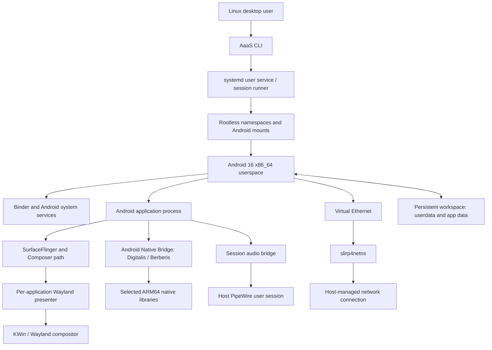

# AaaS architecture overview

This guide describes the accepted `engineering-af3dcb4` developer-preview
architecture. It is a shared-kernel Linux runtime, not a full Android guest VM.
The Fedora VM used for one acceptance environment was only a test host.

## Components and data flow

### Android image and isolation

The bundle carries an Android 16/API 36 x86_64 diagnostic root filesystem.
Android uses the host Linux kernel inside rootless namespace and mount setup;
it is not a hardware-virtualized Android guest. Binder and Android init manage
framework services and application processes. The exact image is a historical
modified M4 diagnostic input and is not reproducibly assembled from a complete
AOSP source lock.

The installation contains immutable runtime artifacts. A separate enrolled
workspace holds persistent Android userdata, installed APK state, and runtime
working data. Installation and workspace separation is part of the CLI's
installation model; uninstall preserves workspace/userdata by default.

### Application windows and graphics

The AaaS session/controller asks Android to create virtual displays for app
windows. Android's SurfaceFlinger/Composer path supplies display buffers to the
host presenter. The presenter creates a Wayland toplevel, handles configure and
input events, submits buffers, and records presentation/release feedback. The
implementation may use DMA-BUF import or a staging-copy path depending on the
available transport; the project does not claim a universally zero-copy path.
KWin/Wayland acceptance verifies actual displayed frames for Settings and
Contacts. A locked or suspended Fedora test desktop can suppress compositor
feedback even when buffers are submitted, so presentation tests require an
active, awake desktop session.

### ARM64 native code

Android's Native Bridge loads selected ARM64 libraries through Digitalis,
which provides a Berberis-based ARM64-to-x86_64 translation path. The accepted
test includes a deterministic ARM64 JNI fixture. This is dynamic translation,
not execution on an ARM processor and not evidence of native-equivalent speed
or compatibility with every ARM64 application.

### Audio and networking

Android audio streams are routed through a session-local AaaS bridge to the
user's PipeWire session. The accepted bundle transported PCM. Earlier Fedora
diagnostic evidence includes a human-confirmed audible test; final candidate
acceptance itself records transport and bytes, not a new listening test.

Android networking uses a virtual Ethernet interface and `slirp4netns` to
connect Android traffic through the host-managed network uplink. The accepted
probe passed DNS and HTTPS (HTTP 204 over TLS 1.3). Physical Wi-Fi hardware and
host SSIDs are not passed through as Android Wi-Fi.

### Lifecycle and ownership

The user service owns the Android runtime session. App windows and their
presenter resources are created on demand. Stop/restart cleanup tracks the
owned process group and helper processes rather than terminating unrelated
processes by name. Accepted lifecycle evidence records stopped service/helper
scope and balanced presenter buffer ownership. Persistent userdata remains in
the workspace across runtime stop/restart and ordinary uninstall.

## Tested scope and limits

The same immutable bundle passed the recorded functional gates on Arch Linux
x86_64 with KDE/KWin Wayland and in a Fedora 45 KDE/KWin 6.8.2 Wayland test VM.
Fedora tests used temporary SELinux permissive mode inside that disposable VM;
Enforcing was restored afterwards. Fedora Enforcing support, production
security approval, broad distribution/compositor support, and public binary
redistribution are not established.

See the [release acceptance record](release/portable-preview-af3dcb4-acceptance.json),
[installation guide](portable-development-release.md),
[security boundary](security/rootless-android-architecture.md), and
[provenance report](dependencies-and-licenses.md).
